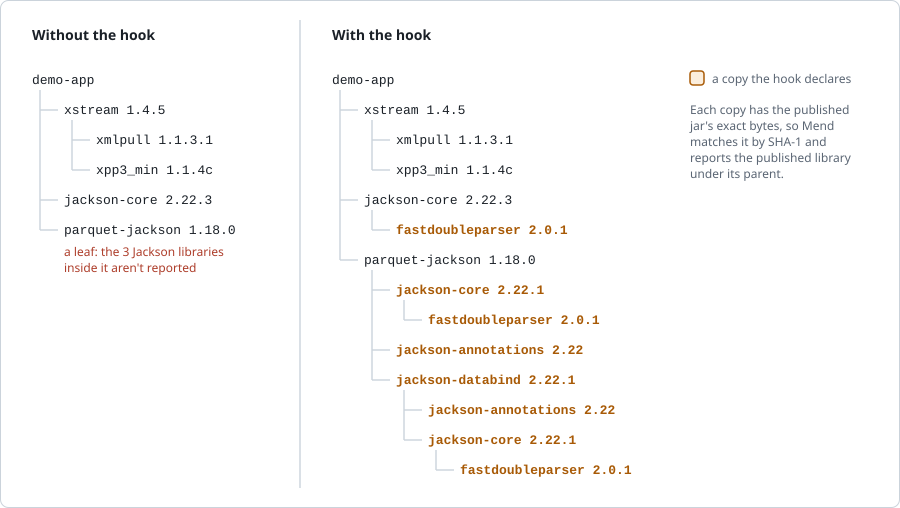

# Shaded dependency hierarchy: a pre-build hook for Mend SCA (Maven)

[shaded_deps_hierarchy.py](./shaded_deps_hierarchy.py) makes the Mend SCA scan report the libraries that a Maven dependency bundles ("shades") inside its own jar.

A shaded jar's published POM doesn't list the libraries it bundles. The Maven scan therefore sees the jar as a leaf, and doesn't report the bundled libraries or their vulnerabilities. 

For example, in [pom.xml](./sample-maven-projects/regular/pom.xml), `org.apache.parquet:parquet-jackson` 1.18.0 bundles three Jackson libraries, and every `jackson-core`, the project's own 2.22.3 included, bundles FastDoubleParser. With the hook, Mend reports each one under the library that bundles it:

<picture>
  <source media="(prefers-color-scheme: dark)" srcset="./images/dependency-tree-dark.svg">
  
</picture>

A library bundled in two places appears under each parent: that's 8 copies here.

Tested with Mend for GitHub Enterprise (self-hosted) 26.9.1.4.

## How it works

The scanner runs the hook in the cloned repository before each scan. For each repository with a `pom.xml` at its root, the hook does the following (if `REPOS` is set, only for the repositories it lists):

1. **Finds bundled libraries.** It resolves the dependencies with Maven and looks inside each dependency jar for:
   - other libraries' `META-INF/maven/<groupId>/<artifactId>/pom.properties`;
   - the jar's own `pom.xml`, when it configures `maven-shade-plugin`.
2. **Declares each one under its parent.** Each bundled library is declared under the library that declares it, through a byte-identical copy of its published jar. The copy's classifier names that parent and every library above it, so its file name spells its whole path, for example `fastdoubleparser-2.0.1-shaded-jackson-core-2.22.1-shaded-jackson-databind-2.22.1-shaded-parquet-jackson-1.18.0.jar`. A name that would be longer than 243 bytes (the filesystem's limit of 255, less the `.lastUpdated` Maven may add) gets a short code for its path instead, such as `hadoop-annotations-3.3.4-shaded-1a2b3c4d.jar`, and the scan log gives the path: `… stands for its whole path, too long for a file name: …`. As a result:
   - a library bundled in several places appears under each parent;
   - the project's own version of a library can't hide a bundled copy;
   - an `<exclusion>` is honored: a bundled library it matches isn't reported there, with what's under it, and the hook logs `Not reported: … an exclusion on its path removes it`. Its classes are still inside the jar that bundles it, though. To report it anyway, set `REPORT_EXCLUDED = True`: Maven matches an exclusion by groupId and artifactId only, so the hook then declares the copy again under groupId `<groupId>.shaded-copy`.
3. **Verifies the tree.** Maven reads the patched POMs from a temporary repository under `.mvn/`, and the hook re-resolves until every copy is in place. It then logs `Verified`.

Mend identifies each copy by its SHA-1 and reports it under its normal name and version. The project's `pom.xml` is never changed, and nothing is pushed to the repository.

### Repositories without pom.xml

A repository can hold a shaded jar as a file, with no `pom.xml` or other build, as Mend's signature and binary scans see it. With `BINARY_JARS` on (the default), the hook then looks for jars in the repository that bundle libraries. Each jar must be named `<artifactId>-<version>.jar` after its own `pom.properties`.
- It declares each such jar in a `pom.xml` that it writes for the scan, as a byte-identical copy of the jar itself.
- The copy gets a minimal POM of the hook's own, so only the libraries found in the jar come in under it.
- The steps above then add those libraries under the jar, so Mend reports them as its transitive dependencies.

### Reachability

Mend's reachability analysis follows the app's `import` lines to the classes of its dependencies, and matches them by class name. A shaded jar often renames ("relocates") the packages it bundles, for example `com.fasterxml.jackson.databind` to `shaded.parquet.com.fasterxml.jackson.databind`. Mend knows a bundled library's vulnerable classes by their original names only, so the app's imports of the renamed classes never meet them, and the bundled libraries' vulnerabilities come out Unreachable even when the app calls that code.

With `REACHABILITY` on (the default), the hook works around it:
- It finds the renamed packages by comparing the class files in the jar with those of the published libraries it bundles.
- For each source file that imports renamed classes, it writes a file with the same package and file name, holding only those imports under their original names. That file goes into a `.shaded-hook-reachability/` folder in the file's module, at the file's own path, for example `.shaded-hook-reachability/src/main/java/com/example/App.java`. Maven never compiles it.
- Mend reads it as the same class as the source file. A reachability trace then starts at the app's class and continues in the library's original classes, for example `com.example.App → com.fasterxml.jackson.databind.ObjectMapper`.

Mend analyzes each module of a multi-module project with that module's own sources, and in testing needed no build. So the hook writes these files into each module whose sources import renamed classes. In the [multi-module sample](./sample-maven-projects/multi-module/pom.xml), only `lib`'s source does, so the file goes into `lib/.shaded-hook-reachability/`, and Mend's trace for the bundled Jackson starts at `com.example.lib.JsonUtil`.

## Samples

[sample-maven-projects/](./sample-maven-projects/) holds the projects the hook is tested on:
- **[regular](./sample-maven-projects/regular/pom.xml):** a Maven project; the example above. Its [app](./sample-maven-projects/regular/src/main/java/com/example/App.java) calls `xstream`, and the bundled Jackson through parquet-jackson's relocated packages, for Mend's reachability analysis.
- **[multi-module](./sample-maven-projects/multi-module/pom.xml):** two modules, `lib` and `app`, each with the regular sample's dependencies; `app` depends on `lib`. For Mend's reachability analysis, [lib's JsonUtil](./sample-maven-projects/multi-module/lib/src/main/java/com/example/lib/JsonUtil.java) calls the bundled Jackson through the relocated packages, and [app's App](./sample-maven-projects/multi-module/app/src/main/java/com/example/App.java) calls `xstream` and `JsonUtil`.
- **[binary-jar](./sample-maven-projects/binary-jar/README.md):** the shaded jar alone, without a `pom.xml`; its README says how to get the jar.

## Requirements

- **Mend for GitHub Enterprise (self-hosted),** with a scan customization repository (see Installation).
- **Maven 3.9 or later and `python3` in the scanner image.** Only the Python standard library is used; tested with Python 3.10. The 26.9.1.4 scanner image includes both. To check:

  ```bash
  docker exec <scanner-container> sh -c 'mvn -v | grep "Apache Maven"; python3 --version'
  ```
- **Access to your Maven repositories.** The scanner must be able to download the published jars of bundled libraries; the hook uses `mvn dependency:get`. In a repository without `pom.xml`, it also uses `maven-help-plugin` 3.5.1 to find the local Maven repository.

## Installation

1. **Customization repository.** Create (or reuse) a repository in an organization where the Mend app is installed, for example `mend-scan-hooks`.
2. **Add the script** as `hooks/common/pre-build/01_shaded_deps_hierarchy.py`:
   - Keep `#!/usr/bin/env python3` as the first line, and keep Unix (LF) line endings. The scanner executes the file directly.
   - Commit it as executable: `git update-index --chmod=+x hooks/common/pre-build/01_shaded_deps_hierarchy.py`.
   - Put nothing else in that folder, including this README. The scanner executes every file in it.
3. **Optionally, configure** the settings at the top of the script (see Configuration). By default the hook acts on every repository with a `pom.xml` at its root, and on every repository without a build that holds jars that bundle libraries. To start with a pilot repository, set `REPOS` to its name.
4. **Point the controller at the repository.** Add this environment variable to the controller container, then recreate the container (for example with `docker compose up -d`). A plain restart doesn't reload environment variables.

   ```
   MEND_GLOBAL_CUSTOMIZATION_REPO=<org>/<repo>
   ```

   To check: `docker exec <controller-container> env | grep MEND_GLOBAL_CUSTOMIZATION_REPO`

## Configuration

| Setting | Default | What to set |
|---|---|---|
| `REPOS` | `""`: every repository | Space-separated names of the repositories to act on, for example one pilot repository first. Leave empty for all repositories. |
| `MVN_LOG_LEVEL` | `""`: normal Maven output | `-X` (debug) while troubleshooting, `-q` for errors only. |
| `MAX_ROUNDS` | `10` | Leave as is. It limits the re-resolution rounds used to follow nested shading. |
| `BINARY_JARS` | `True`: in a repository without `pom.xml`, report what its jars bundle | `False` to leave repositories without a `pom.xml` alone. See "Repositories without pom.xml". |
| `REACHABILITY` | `True`: write the app's imports of renamed (relocated) classes under their original names, for Mend's reachability analysis | `False` leaves the sources alone. See "Reachability". |
| `HARD_LINKS` | `True`: each copy of a bundled library in the scanner's local Maven repository is a hard link to the published jar, taking no disk space of its own | `False` writes full copies instead, as earlier versions of the hook did. |
| `REPORT_EXCLUDED` | `False`: a bundled library that an `<exclusion>` on its path matches isn't reported there, as Maven leaves it out | `True` reports it anyway, since its classes are still inside the jar that bundles it. See "How it works". |

The hook runs for every scan in the organization. It exits immediately for a repository without a `pom.xml` at its root, unless the repository has no build at all and holds a jar that bundles libraries, and, when `REPOS` is set, for a repository it doesn't list.

## Verifying

1. **Trigger a scan** of a repository the hook acts on (one listed in `REPOS`, if you set it): push a commit that triggers a scan, for example a change to `.whitesource`.
2. **Read the hook's output** in the scanner's scan log. Each line is prefixed with the hook path and scan context:

   ```bash
   docker exec <scanner-container> sh -c 'grep -h "\[shaded-hook\]" /tmp/sca_*.log | grep -v "mvn -B" | tail -40'
   ```

   Look for `Shaded in <jar>: <library>` lines and a closing line like this one, followed by the final dependency tree. In a repository without `pom.xml`, a line `Jars that bundle libraries, in a repository without pom.xml: <path> (<groupId>:<artifactId>:<version>)` comes first:

   ```
   [shaded-hook] Verified: all 8 bundled dependencies resolve, each as its own copy under the library that declares it (8 copies)
   ```

   The scan log line that runs the hook contains `execution success; exit code: 0`.

   For reachability (see "Reachability"), look for `Relocated in <jar>: <n> packages of <libraries>` lines, and one `Reachability: <source file>: its imports of relocated classes, under their original names, in <file>` line for each source file that imports renamed classes.
3. **Check Mend.** The bundled libraries appear as transitive dependencies of the library that bundles them, with their vulnerabilities, in the project and in its SBOM export.

## What to expect

- **Fixing findings.** A vulnerability in a bundled library is fixed by upgrading the library that bundles it (for example, a newer `parquet-jackson`), not the bundled library itself. Mend's fix suggestions may still name the bundled library.
- **Runtime.** The hook adds a few Maven runs to each scan of a repository it acts on; in testing this was about 10 to 30 seconds for a small project. A repository without shaded jars costs one extra `mvn dependency:list`. A multi-module repository costs one more `mvn dependency:tree`. In a repository without `pom.xml`, the hook first looks through the repository for jars. If it finds one that bundles libraries, it adds a `mvn help:evaluate`, plus a `mvn dependency:get` for each such jar whose POM isn't cached.
- **Files in the scanner's local Maven repository.** The copies are written to the scanner's local Maven repository (`~/.m2/repository`), because the scanner identifies jars only there.
  - They are byte-identical to published jars, under coordinates that no public repository publishes.
  - With `HARD_LINKS` on (the default), each copy of a bundled library is a hard link to the published jar, so it takes no disk space of its own. Changing `HARD_LINKS` affects only copies written afterwards; to rewrite the existing ones, delete them (step 2 of "Removing the hook"), and the next scan writes them again.
  - Mend's library page lists them under "Library Found In": one path for each place the library is bundled, each file name spelling that place's path, or giving its short code (see "How it works").
  - Maven keeps one POM per version. So when the same library version has bundled libraries of its own in more than one place, its copies after the first get a version of their own, `<version>-own2`, `-own3` and so on, for example `jackson-core-2.22.1-own2-shaded-jackson-databind-2.22.1-shaded-parquet-jackson-1.18.0.jar`.
  - In a repository without `pom.xml`, each jar the hook declares is copied there too, as `<artifactId>-<version>-shaded-binary-<version>.jar`. That is the committed jar itself, which may be an internal one.
  - They never overwrite existing files, stay between scans and don't affect other builds.
- **Changes in the clone only.** The hook adds two lines to `.mvn/maven.config` and creates `.mvn/shaded-overlay-repo/`. Both are excluded from the file scan, and the scanner deletes the clone after the scan. In a repository without `pom.xml`, the hook also writes a `pom.xml` that declares the jars that bundle libraries. With `REACHABILITY` on, it also writes `.shaded-hook-reachability/` folders, one in each module whose sources import renamed classes.
- **Reachability verdicts.** Existing projects may see vulnerabilities of bundled libraries move from Unreachable to Reachable. Mend matches classes by name, so another copy of the same library in the project, such as its own `jackson-core` 2.22.3, also counts as reached.
- **If the hook fails** (a Maven error, or a jar it can't read), it removes its changes and exits 1.
  - The scan runs as if the hook weren't installed, and the SCA result shows a Warning.
  - If your check runs use `strictMode: failOnWarning`, that check fails.

## Limitations

- **Maven projects,** with a `pom.xml` at the repository root, **or jars committed to a repository without one.** Gradle and other build tools aren't covered.
- **Jars in a repository without pom.xml.**
  - Only a jar named `<artifactId>-<version>.jar` after its own `pom.properties` is recognized.
  - Jars are only looked at in a repository without a build: no `pom.xml`, `build.gradle(.kts)`, `settings.gradle(.kts)` or `build.sbt` in any folder. A Maven project in a subfolder, or a Gradle or sbt build, is left to its own scan.
  - For a jar that isn't published where Maven looks (internal or unpublished), only the libraries with their own `pom.properties` in it are reported.
  - The `pom.xml` the hook writes takes its `<packaging>` from the jar's own `pom.xml` (Maven's default, `jar`, if it has none). A packaging that needs a Maven plugin, such as `bundle`, makes Maven fail; the hook then removes its changes and exits 1.
- **Maven metadata needed.** Bundled libraries are found only through Maven metadata in the jar: the bundled library's `pom.properties`, or the jar's own `pom.xml` with a `maven-shade-plugin` configuration. Relocated code without metadata is only logged, as `contains relocated code with no Maven metadata`.
- **Dependencies a bundled library inherits from its parent POM.** Each copy keeps its library's published POM, parent included, so a dependency the parent declares for all its modules can resolve under the copy even when the jar doesn't contain it. If no shaded jar contains it, the hook excludes it (`Excluding libraries the shaded jars don't contain`). If another shaded jar bundles it, excluding it would also remove that copy, so it stays, with the line `Not excluded: …`. Mend then reports it under this library too: a false positive rather than a missed library. For example, `hadoop-client-api` 3.3.4 bundles `hadoop-mapreduce-client-core`, whose parent `hadoop-mapreduce-client` declares `protobuf-java`, `avro` and `hadoop-annotations`. Mend lists all three under `hadoop-mapreduce-client-core`, though `protobuf-java` and `avro` aren't in `hadoop-client-api`'s jar at all.
- **Reported as the published library.** Bundled code is reported as the published library (matched by SHA-1), not as the relocated classes.
- **Exclusions with `REPORT_EXCLUDED = True`.** A `*:*` exclusion matches every groupId, so the copies under that dependency stay hidden, with the warning `doesn't resolve it there`. When the exact bytes of a copy under `<groupId>.shaded-copy` are also published under another name, Mend may report it under that other name.
- **Reachability.**
  - Only `import` lines count, as in Mend's analysis.
  - A renamed bundle *inside* a bundled library isn't followed, for example FastDoubleParser inside `jackson-core`. Mend's analysis doesn't follow it even without the hook.
  - Mend matches classes by name, so reaching `com.fasterxml.jackson.core.X` also counts for any other `jackson-core` in the project, such as its own 2.22.3.
  - Renamed packages are matched by their class files. A package with only `package-info` is skipped, and so is one whose original isn't certain: several candidates, or fewer than 3 classes and a name that doesn't end with the original's.
  - It depends on Mend reading `.java` files in hidden folders. If that changes, reachability falls back to the results without the hook.
- **Multi-module projects** work without a build. The jars the modules depend on are inspected, but not the modules' own jars, which aren't built when the scanner runs. For a module that another module depends on, the hook's own Maven runs use an empty placeholder jar. The scanner never sees it.
- **Not tested:** private Maven registries and very large projects.

## Troubleshooting

| Symptom in the scan log | Cause and fix |
|---|---|
| No `[shaded-hook]` lines | The controller doesn't have `MEND_GLOBAL_CUSTOMIZATION_REPO`, the Mend app can't access the customization repository, or the script isn't in `hooks/common/pre-build/`. |
| Only the hook's first line (`[shaded-hook] repo=<name> dir=…`) | The repository has no `pom.xml` at its root, and either has a build in a subfolder or no jar that bundles libraries (or `BINARY_JARS` is `False`), or `REPOS` is set and doesn't list it. |
| `Exec format error` | The first line isn't `#!/usr/bin/env python3`. |
| `/usr/bin/env: 'python3\r': No such file or directory` | The file has Windows line endings. Convert it to LF. |
| `/usr/bin/env: 'python3': No such file or directory` | The scanner image has no Python 3. |
| `WARNING: …; removing the overlay - shaded libraries won't be reported` | The hook rolled back. The lines above it show the Maven or Python error; set `MVN_LOG_LEVEL="-X"` for more detail. |
| `WARNING: … isn't readable XML, even as Maven reads it …` | That POM (a published POM, a parent POM, or the `pom.xml` inside a jar) is damaged, so the hook goes on as if it weren't there, and what it would have read from it is missing. For example, a library whose published POM it is has its bundled dependencies unreported. A POM that only Maven reads, such as `hadoop-project` 3.1.0 with its `<Xlint:-unchecked/>`, is read the way Maven reads it, without a warning. |
| `WARNING: couldn't fetch …` | The scanner can't download that published jar from your Maven repositories, so that library isn't reported. |
| `nested deeper than MAX_ROUNDS` | Shading is nested deeper than the round limit. Increase `MAX_ROUNDS`. |
| `WARNING: couldn't write the reachability imports …` | The hook couldn't read a source file or write the file next to it (that file is skipped), or failed otherwise (then none are written). The reported dependencies are unaffected; reachability is as without the hook. The lines above it show the error. |

## Removing the hook

1. Delete `hooks/common/pre-build/01_shaded_deps_hierarchy.py` from the customization repository. The next scan runs without the hook. To stop it for some repositories only, list the others in `REPOS`.
2. Optionally, remove the copies from the scanner's local Maven repository. This lists them:

   ```bash
   docker exec <scanner-container> sh -c 'find ~/.m2/repository -name "*.jar" | awk -F/ "index(\$NF, \$(NF-2) \"-\" \$(NF-1) \"-shaded-\") == 1"'
   ```

   To delete them, add `| xargs rm -f` after the `awk` command, inside the quotes. The filter matches only jars named `<artifactId>-<version>-shaded-…`, so published artifacts such as `hadoop-shaded-guava` are left alone. Deleting a copy that is a hard link removes only its name; the published jar stays.
